<p align="center">
  <picture>
    <source media="(prefers-color-scheme: dark)" srcset="assets/banner-dark.svg">
    <source media="(prefers-color-scheme: light)" srcset="assets/banner-light.svg">
    
  </picture>
</p>

<p align="center">
  <a href="https://www.giacomoferlaino.com/en/"></a>
  <a href="https://www.linkedin.com/in/giacomo-ferlaino/"></a>
  <a href="https://x.com/GFerlaino_"></a>
  <a href="mailto:contact@giacomoferlaino.com"></a>
  <a href="https://cal.com/giaco-ferla"></a>
</p>

<p align="center">
  <code>$ trail --map</code><br><br>
  <a href="#start">🌲 start</a> ──▶
  <a href="#camp">🏕️ camp</a> ──▶
  <a href="#shared-trails">🤝 shared trails</a> ──▶
  <a href="#journey">🧭 journey</a> ──▶
  <a href="#backpack">🎒 backpack</a> ──▶
  <a href="#lookout">🔭 lookout</a>
</p>

---

<a id="start"></a>

## 🌲 Start · about me

```ts
// ~/forest/start/about.ts
const giacomo = {
  role: ["IT Project Manager", "Founder & Engineer"],
  basedIn: "Paris, France",
  shipping: "software from the idea to production, since 2017",
  previously: "Co-founder & CTO @ Registered",
  building: ["Scripta", "TaBello"],          // agentic AI · open source
  contributesTo: ["DoveVannoINostriSoldi"],  // open source owned by others
  speaks: ["it", "fr", "en", "es"],
} as const;
```

I work between the people who ask for software and the people who build it. I co-founded **Registered**, a marketplace for the dance world, and was its CTO all the way to the Culttech accelerator in Vienna; along the way I worked as an independent consultant and IT project manager for SMEs and startups. Today I build generative and agentic AI apps and open-source tools.

> My full CV is a 3D forest you can walk through: **[giacomoferlaino.com](https://www.giacomoferlaino.com/en/)** · or the [classic CV](https://www.giacomoferlaino.com/en/cv)

<a id="camp"></a>

## 🏕️ Camp · my projects

```console
$ ls ~/projects
taBello/   scripta/   giacomoferlaino.com/   demopen/
```

<table>
<tr>
<td>

**📂 [taBello/](https://github.com/JackF007/taBello)** · turn any recording into guitar, bass and ukulele tabs · `[LIVE · BETA]`  
Creator · 2025 -  
A free, open-source desktop app I built for my own guitar. It detects the notes with a machine-learning model, isolates the instrument from a band recording (Demucs), reads the frets from the hand in videos (MediaPipe) and writes notation plus tablature with chords, techniques and tempo changes. Playback, loop and slow-down, export to Guitar Pro and MIDI. No account, no upload: it runs entirely offline.  
`TypeScript` `React` `Electron` `TensorFlow.js` `ONNX Runtime` `Demucs` `FFmpeg`  
[Source code](https://github.com/JackF007/taBello) · GPL-3.0

</td>
</tr>
<tr>
<td>

**📂 scripta/** · agentic AI coaching in your pocket · `[IN PROGRESS]`  
Concept &amp; development · 2026 -  
An agentic AI mobile app for personal growth, writing and conversational coaching.  
`TypeScript` `Python` `Openfang` `Groq` `PostgreSQL` `RevenueCat` `Hetzner` `Cloudflare`

</td>
</tr>
<tr>
<td>

**📂 [giacomoferlaino.com/](https://www.giacomoferlaino.com/en/)** · my CV as a 3D forest · `[LIVE]`  
Concept, writing &amp; development · 2026 -  
A CV in three languages (EN, FR, IT) to explore by walking through a 3D forest, with ambient sound, a 2D fallback and a chess board where you can play against an easy version of me. Designed, written and built by me.  
`TypeScript` `Three.js` `Vite` `Web Audio` `Cloudflare`

</td>
</tr>
<tr>
<td>

**📂 demopen/** · public-administration services as a social network · `[NEVER LAUNCHED]`  
Founder &amp; project manager · 2018  
A social network to access Italian public administration services, before the official IO app existed: news, investment calls, public competitions by field, downloadable documents and open data. Finished, never reached the market.  
`Java` `Android` `PHP` `JavaScript` `AWS`  
[Android app](https://github.com/JackF007/demOpen_Android) · [Back-end](https://github.com/JackF007/dmeOpen_PHP)

</td>
</tr>
</table>

<a id="shared-trails"></a>

## 🤝 Shared trails · open-source contributions

Projects **owned and maintained by others**, where I contributed.

```console
$ gh search prs --author=JackF007 --merged
✔ #768  Italian-Builders-Org/DoveVannoINostriSoldi
        fix(siope): headline without the partial month, consolidated totals side by side
```

| Project | Owner | My contribution |
| --- | --- | --- |
| **[DoveVannoINostriSoldi](https://github.com/Italian-Builders-Org/DoveVannoINostriSoldi)** | [Italian Builders](https://github.com/Italian-Builders-Org) | Civic open-source atlas of Italian public spending, from official sources. [PR #768](https://github.com/Italian-Builders-Org/DoveVannoINostriSoldi/pull/768) (merged): SIOPE headline without the partial month, with consolidated totals side by side. |
| **[AlboPOP](https://albopop.it/)** | AlboPOP community | Open-source civic project that turns municipal notice boards into RSS feeds and Telegram channels. I brought it to 6+ municipalities in Calabria (Terranova da Sibari, Tarsia, Platania, Spezzano Albanese and others) and I'm [credited](https://albopop.it/comune/terranovadasibari/) as the author of their pages. |

<a id="journey"></a>

## 🧭 Journey · work

```console
$ git log --oneline --reverse career
2017  alteredu     Digital PM · led Demopen with a remote team of 5 mobile devs
2019  servizi-st   IT PM & L2 support · CMDBuild integration, ITIL
2020  registered   co-founded · Co-founder & CTO
2020  freelance    IT consultant for SMEs & startups, until 2025
2025  tabello      open-source tabs from any recording · public beta
2026  registered   closed after six years · ~50 events, tens of thousands of registrations
2026  scripta      agentic AI coaching app · in progress          (HEAD -> now)
```

<table>
<tr>
<td>

**Registered** · the marketplace for the dance world · `[CLOSED]`  
Co-founder &amp; CTO · Mar 2020 - Jun 2026 · Rome, remote  
Led architecture and development of the e-commerce platform, from scoping to production, managing 3 external developers: a web app in four languages (IT, EN, FR, DE), a shop for every organizer, group registrations and Stripe payments. Ran registrations for nearly 50 national and international dance events, including Hip Hop International Italy and Switzerland: tens of thousands of online registrations. Incubated by the Culttech accelerator in Vienna.  
`AWS` `Stripe` `Vue.js` `Laravel` `MySQL` `Plesk`

</td>
</tr>
<tr>
<td>

**Independent IT consultant** · development, integrations and technical consulting for SMEs and startups  
Freelance · Oct 2020 - Nov 2025 · Italy and remote

- **APL System** (2022-2025) · analyst developer: built from scratch *Contratti APL*, the in-house CRM for e-invoices and contracts; integrated bulk invoice sending with the FTPA TosNet REST APIs; managed a fleet of VMware ESXi virtual machines, in-house and at clients' sites; coordinated the new company website.  
  `Visual FoxPro 9` `SQL Server` `REST API` `VMware ESXi` `WordPress`
- **DenunciaOnline** (2024) · back-end developer: APIs, webhooks, Slack and Calendly integrations.  
  `JavaScript` `React` `REST API` `Bitbucket`
- **Client websites**: [rosaneldeserto.it](https://rosaneldeserto.it/) (Flazio), boskiebowloskie.com (Webflow).

</td>
</tr>
<tr>
<td>

**Servizi s.t.** · IT Project Manager &amp; level-2 support  
Jan 2019 - Mar 2020 · Bolzano  
Led the in-house integration of CMDBuild (open-source CMDB and ITSM platform) for a transport company in South Tyrol: support processes digitised, CI modelling, go-live. Optimised processes and data management with an ITIL approach; handled level-2 escalations.  
`CMDBuild` `ITSM` `ITIL`

</td>
</tr>
<tr>
<td>

**Alteredu** · certified online learning platform  
Digital Project Manager · Dec 2017 - Dec 2018 · Rende  
Led the development of Demopen, coordinating a remote outsourced team of 5 mobile developers. Improved the website and the online courses with the lead developer.  
`WordPress` `WooCommerce`

</td>
</tr>
</table>

<a id="backpack"></a>

## 🎒 Backpack · tech stack

```console
$ cat ~/backpack.json
```

```json
{
  "languages": ["TypeScript", "JavaScript", "PHP", "Python", "Java", "SQL"],
  "frontend":  ["React", "Vue.js", "Three.js", "Tailwind CSS", "Vite"],
  "backend":   ["Laravel", "Node.js", "Electron", "PostgreSQL", "MySQL", "SQL Server",
                "REST APIs", "webhooks"],
  "ai_ml":     ["TensorFlow.js", "ONNX Runtime", "Demucs", "MediaPipe", "Groq",
                "agentic workflows"],
  "infra":     ["AWS", "Cloudflare", "Hetzner", "Docker", "Linux", "VMware ESXi", "Git"],
  "delivery":  ["Project management", "Agile", "ITIL", "Stripe", "RevenueCat"]
}
```

<details>
<summary><code>$ ls -la ~/archive</code> · older and smaller repositories</summary>

<br>

| Repository | What |
| --- | --- |
| [ecommerce_crud_app](https://github.com/JackF007/ecommerce_crud_app) | Laravel CRUD API for an e-commerce product catalog, with Eloquent factories. |
| [Gestione_Palestra_Battle_CADMO](https://github.com/JackF007/Gestione_Palestra_Battle_CADMO) | Gym management web app: members, slot bookings, back-office. Plain PHP and MySQL. |
| [MasterZ-Giaco-Ferlaz-Token](https://github.com/JackF007/MasterZ-Giaco-Ferlaz-Token) | Solana experiments in TypeScript: SPL token mint and transfers, NFT minting, airdrops, Jupiter swaps. |
| [demOpen_Android](https://github.com/JackF007/demOpen_Android) · [dmeOpen_PHP](https://github.com/JackF007/dmeOpen_PHP) | Demopen's Android app and PHP back-end (2018). |

</details>

<a id="lookout"></a>

## 🔭 Lookout · contact

```console
$ exit
logout: the trail ends here, the conversation doesn't.
```

<p align="center">
  For a project, a role or a question:<br>
  <a href="https://www.giacomoferlaino.com/en/"><strong>giacomoferlaino.com</strong></a> ·
  <a href="https://cal.com/giaco-ferla">book a call</a> ·
  <a href="mailto:contact@giacomoferlaino.com">contact@giacomoferlaino.com</a> ·
  <a href="https://www.linkedin.com/in/giacomo-ferlaino/">LinkedIn</a> ·
  <a href="https://x.com/GFerlaino_">X</a>
</p>
